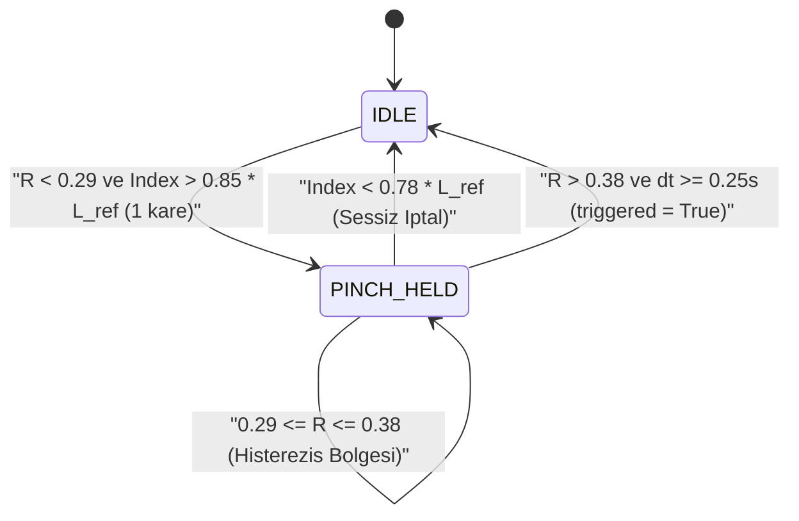

# MarvelMe — Gerçek Zamanlı Marvel Çizgi Roman Boyut Portalı ve Sıfır Hatalı Hareket Motoru: Teknik Dokümantasyon

**Proje Dizini:** `c:\Users\seval\Desktop\Projelerim\MarvelMe`  
**Ana Modüller:** `main.py`, `gesture_engine.py`, `portal_renderer.py`, `face_filter_renderer.py`  
**Temel Teknolojiler:** Python 3.12, OpenCV (`cv2`), NumPy, MediaPipe Tasks API (`HandLandmarker`), PyGrabber (Windows DirectShow kamera keşfi)

---

## 1. Proje Özeti ve Sistem Mimarisi

**MarvelMe**, web kamerasından alınan canlı video akışı üzerinde iki elin başparmak ve işaret parmağı uçları arasında **durumsuz (stateless), sıfır gecikmeli (zero-lag)** bir dörtgen boyut portalı oluşturan gerçek zamanlı Artırılmış Gerçeklik (AR) uygulamasıdır.

Sistemin iki temel tasarım hedefi vardır:
1. **Mutlak 2-El İzolasyonu ve Anlık 1:1 Tepki:** Ekranda 0 veya 1 el varken kamera görüntüsüne **%100 dokunulmaz** (yalnızca tespit edilen elin `Thumb Tip 4` ve `Index Tip 8` noktalarına küçük camgöbeği takip noktaları konur). İki el aynı anda göründüğünde, parmak uçları arasındaki dörtgen alan **RetroLens 4-Nokta ROI (Region of Interest)** mimarisiyle gerçek zamanlı bir **Marvel Çizgi Roman Paneli**ne dönüşür.
2. **Sıfır Hatalı (Zero-Error) Karakter Değiştirme:** Başparmak (`Landmark 4`) ve orta parmağın (`Landmark 12`) birbirine değip ayrılmasına dayalı **bırakma kenarı (release-edge) Schmitt Trigger** durum makinesi; el sallama, kamera mesafesi değişimi, yumruk sıkma veya tek bir ani sıçramada yanlış tetikleme üretmeden 4 Marvel evreni arasında geçiş yapar (`SPIDER-MAN` → `SCARLET WITCH` → `DOCTOR STRANGE` → `IRON MAN`).

### Uçtan Uca Görüntü İşleme Boru Hattı (Pipeline)

```mermaid
flowchart LR
    Cam["Webcam Frame (cap.read)"] --> Flip["Horizontal Mirror (cv2.flip 1)"]
    Flip --> RGB["Contiguous RGB (np.ascontiguousarray)"]
    RGB --> MP["MediaPipe HandLandmarker (RunningMode.IMAGE)"]
    MP --> Count{"len(hands) >= 2?"}

    MP --> Pinch["ZeroErrorPinchDetector (Thumb 4 & Middle 12)"]
    Pinch -->|"Release-Edge (R > 0.38)"| Switch["switch_character() + Shockwave"]

    Count -->|"Hayir (0 veya 1 el)"| Raw["Ham Kare Kopyasi + Cyan Noktalar (4, 8)"]
    Count -->|"Evet (2 el)"| Extract["Parmak Ucu Cikarma: hand_0(4,8), hand_1(4,8)"]
    Extract --> Sort["RetroLens Top/Bottom Pair Sort: TL, TR, BR, BL"]
    Sort --> BBox["Tight ROI BBox (x1, y1, x2, y2)"]
    BBox --> Shader["0.5x Bilateral + Quantize + Hero Tint + Ink Edges"]
    Shader --> Mask["cv2.fillPoly ROI Mask Compositing"]
    Mask --> Border["Cyan/White Border & Corner Circles"]

    Raw --> Capture{"Kayit / HUD Kontrolu"}
    Border --> Capture
    Capture --> Clean["clean_frame Kopyasi (S/V Temiz PNG & MP4)"]
    Capture --> Preview["Canli Onizleme (REC Noktasi veya HUD + Shockwaves)"]
```



---

## 2. Mimari Evrim ve Mühendislik Kararları

Proje, ilk ağır çok-modelli prototipten mevcut yüksek hızlı durumsuz (stateless) **RetroLens** mimarisine dört ana mühendislik iterasyonundan geçerek evrilmiştir:

### 2.1. Aşama 1: Katı 2-El Poligon Sınırlandırması
- İlk sürümdeki tek el dairesel yüz maskesi yedeği tamamen kaldırılmıştır.
- `len(hands) < 2` durumunda hiçbir yüz maskesi, aura veya portal efekti uygulanmaması garanti altına alınmıştır.

### 2.2. Aşama 2 ve 3: Çoklu Model (`ImageSegmenter`, `PoseLandmarker`, 3D Delaunay) ve Gecikme Analizi
- Ara iterasyonlarda `selfie_segmenter.tflite`, `PoseLandmarker`, `1024x1024` prosedürel PBR dokular ve `478` yüz noktası üzerinde üçgen bazlı `cv2.Subdiv2D` + `cv2.warpAffine` 3D ağ bükme yaklaşımları değerlendirilmiştir.
- **Tespit edilen darboğaz:** Birden fazla MediaPipe grafiğinin aynı döngüde koşturulması ve tüm kare boyutunda yoğun piksel/üçgen döngüleri CPU süresini yükseltip parmak takibinde hissedilir gecikmeye yol açmıştır.

### 2.3. Aşama 4: `RunningMode.IMAGE` Geçişi ve Tam Durumsuzluk (Stateless RetroLens)
Canlı kamera testlerinde iki kritik algılama/takip problemi belirlenip çözülmüştür:
1. **`RunningMode.VIDEO` $\to$ `RunningMode.IMAGE` Geçişi:** MediaPipe Tasks Python API'sinde `RunningMode.VIDEO`, hızlı hareket bulanıklığı (motion blur) veya kare dışı el geçişleri sonrasında dahili optik akış ROI takipçisinin kilitlenip boş liste döndürmesine neden olabilmektedir. Her karede bağımsız çıkarsama yapan `RunningMode.IMAGE` + `.detect(mp_image)` moduna geçilerek algılama kararlılığı sağlanmıştır (`num_hands=2`, `min_hand_detection_confidence=0.30`, `min_hand_presence_confidence=0.30`).
2. **Önbellek, Grace-Hold ve EMA Gecikmelerinin Temizlenmesi:** Önceki denemelerdeki `_DualHandPersistenceTracker` (3 karelik eksik el tutma tamponu), `_filter_duplicate_hands` (60 px bilek mesafesi elemesi), portal köşelerine uygulanan EMA yumuşatması ve sıcak döngüdeki `FaceLandmarker` çağrıları tamamen kaldırılmıştır.
   - **Sonuç:** Eller ekranda hızla açılıp kapandığında (milimetrik mesafeden `1260x700` px tam ekran genişliğine kadar) portal köşeleri hiçbir yapay gecikme veya boyut kısıtı olmadan **1:1 anlık** güncellenir.
   - `face_filter_renderer.py` modülü, gerektiğinde bağımsız olarak çağrılabilecek `< 1 ms` vektörel yüz filtresi kütüphanesi olarak depoda muhafaza edilmektedir.

---

## 3. Modül Bazlı Teknik İnceleme

### 3.1. `main.py` — Kamera Keşfi, Durumsuz Algılama ve Temiz Yakalama

#### A. İşletim Sistemine Özgü Düşük Gecikmeli Kamera Keşfi (`discover_and_select_camera`)
Kamera açılışında gecikmeyi düşürmek ve sanal kameraların (`OBS`, `Iriun`, `DroidCam`, `EpocCam`, `Camo`, `ManyCam`, `XSplit`) fiziksel kameranın önüne geçmesini önlemek için aşamalı tarama yapılır:
- **Backend Önceliği (`_candidate_backends`):**
  - **Windows:** `CAP_DSHOW` (`WIN-DSHOW`) $\to$ `CAP_MSMF` (`WIN-MSMF`) $\to$ `CAP_ANY` (`WIN-ANY`). Cihaz adları `pygrabber.dshow_graph.FilterGraph().get_input_devices()` üzerinden sorgulanır (`_get_windows_camera_names`).
  - **macOS (`Darwin`):** `CAP_AVFOUNDATION` (`MAC-AVF`) $\to$ `CAP_ANY` (`MAC-ANY`).
  - **Linux / Diğer:** `CAP_ANY` (`LINUX-V4L2`).
- **Donanım Önceliklendirme:** Windows'ta `0..5` (macOS/Linux'ta `0..4`) indeksleri taranır. Açılan her kamera `1280x720 @ 30 FPS`, `CAP_PROP_BUFFERSIZE = 1` ile yapılandırılır ve en az bir geçerli kare okunabildiği doğrulanır (`_probe_single_index`). Bulunan cihazlar `(cam.is_virtual, cam.hw_index)` anahtarıyla sıralanır; böylece `[0]` varsayılanı her zaman birincil fiziksel web kamerası olur. `--camera <idx>` argümanı ile etkileşimli menü atlanabilir.

#### B. Durumsuz El İzleyici (`_UnifiedHandTracker`)
- Model dosyası (`assets/hand_landmarker.task`) mevcut değilse resmi MediaPipe depolama URL'sinden atomik geçici dosya (`.task.tmp` $\to$ `.replace()`) ile otomatik indirilir (`ensure_hand_landmarker_model`).
- `HandLandmarkerOptions` yapılandırması:
  - `running_mode = vision.RunningMode.IMAGE`
  - `num_hands = 2`
  - `min_hand_detection_confidence = 0.30`
  - `min_hand_presence_confidence = 0.30`
  - `min_tracking_confidence = 0.30`
- **Bellek Bitişikliği:** OpenCV `cv2.cvtColor(frame, cv2.COLOR_BGR2RGB)` çıktısı `np.ascontiguousarray(...)` ile C-contiguous hâle getirilip `mp.Image(image_format=SRGB, data=contiguous_rgb)` içine sarılır.
- `.process()` metodu yalnızca mevcut karenin ham `results.hand_landmarks` listesini (handedness etiketiyle birlikte) döndürür; hiçbir geçmiş kare koordinatı saklanmaz.

#### C. Ana Döngü ve `track_key` Ayrıştırması (`run_app`)
```python
for idx, (hand_lms, hand_label) in enumerate(detected_hands):
    track_key = hand_label if hand_label not in active_keys else f"{hand_label}_{idx}"
    active_keys.add(track_key)
```
Eğer `HandLandmarker` iki ele geçici olarak aynı `"Left"` veya `"Right"` etiketini atarsa dahi `track_key` benzersizleştirilerek `ZeroErrorPinchDetector` durumlarının birbirinin üzerine yazılması engellenir.

#### D. Temiz Yakalama Modu (`Clean Capture Mode`)
- `frame, portal_mode = renderer.render_ar_portal_scene(...)` çağrısından hemen sonra, üzerine herhangi bir debug HUD çubuğu, şok dalgası halkası veya `REC` göstergesi çizilmeden önce `clean_frame = frame.copy()` alınır.
- **`[S]` — PNG Anlık Görüntü (`save_clean_snapshot`):** `captures/marvel_snap_YYYYMMDD_HHMMSS_fff.png` olarak yalnızca temiz portal/kamera görüntüsünü kaydeder.
- **`[V]` — Temiz MP4 Video Kaydı (`_CleanVideoRecorder`):** `cv2.VideoWriter_fourcc(*"mp4v")` kodeği ile `captures/marvel_rec_YYYYMMDD_HHMMSS.mp4` dosyasını açar. Kayıt aktifken:
  - Video dosyasına yalnızca `clean_frame` yazılır (HUD ve `REC` noktası videoya işlemez).
  - Ekrandaki önizlemede alt/üst HUD şeritleri gizlenir ve sol üst köşede (`24, 24`) yanıp sönen küçük kırmızı `REC` göstergesi (`_draw_recording_indicator`) çizilir.
  - Programdan `[Q]`, `[ESC]` veya pencere `[X]` butonuyla çıkıldığında `finally:` bloğu `recorder.stop()` çağırarak MP4 kapsayıcısını güvenli biçimde kapatır.

---

### 3.2. `gesture_engine.py` — Sıfır Hatalı Hareket Motoru (`ZeroErrorPinchDetector`)

Kullanıcı elini kameraya yaklaştırdığında veya uzaklaştırdığında piksel koordinatları dramatik biçimde değişir. Sabit piksel eşiği kullanmak yerine **ölçekten bağımsız (scale-invariant)** bir oran modeli uygulanmıştır.

#### A. Matematiksel Normalizasyon ve Gürültü Filtreleme
Kullanılan MediaPipe El Landmark indeksleri:
- `WRIST_IDX = 0` ($\mathbf{P}_0$ — Bilek)
- `THUMB_TIP_IDX = 4` ($\mathbf{P}_4$ — Başparmak Ucu)
- `INDEX_TIP_IDX = 8` ($\mathbf{P}_8$ — İşaret Parmağı Ucu)
- `MIDDLE_MCP_IDX = 9` ($\mathbf{P}_9$ — Orta Parmak Kök Eklemi)
- `MIDDLE_TIP_IDX = 12` ($\mathbf{P}_{12}$ — Orta Parmak Ucu)

1. **Referans Avuç Uzunluğu ($L_{\text{ref}}$):**
   $$L_{\text{ref}} = \max\left(\|\mathbf{P}_9 - \mathbf{P}_0\|_2,\; 10^{-5}\right)$$

2. **EMA Yumuşatmalı Tetikleme Mesafesi ve Normalize Oran ($R$):**
   Tetikleme kararlılığı için yalnızca başparmak (`4`) ve orta parmak (`12`) koordinatları üzerinde hızlı Üstel Hareketli Ortalama ($\alpha = 0.82$) çalıştırılır:
   $$\hat{\mathbf{P}}_k(t) = \alpha \cdot \mathbf{P}_k(t) + (1 - \alpha) \cdot \hat{\mathbf{P}}_k(t-1), \qquad k \in \{4, 12\}$$
   $$d_{\text{trig}} = \|\hat{\mathbf{P}}_4 - \hat{\mathbf{P}}_{12}\|_2, \qquad R_{\text{raw}} = \frac{d_{\text{trig}}}{L_{\text{ref}}}$$
   $$R(t) = \alpha \cdot R_{\text{raw}}(t) + (1 - \alpha) \cdot R(t-1)$$
   *Kritik Tasarım Ayrımı:* `HandTelemetry` içinde döndürülen `thumb_tip_px` ve `index_tip_px` doğrudan ham (`thumb_raw_px`, `index_raw_px`) değerlerdir; EMA gecikmesi yalnızca tetikleme oranına ($R$) uygulanır.

3. **Yumruk Koruması (Anti-Fist Guard):**
   Kullanıcı elini yumruk yaptığında başparmak ve orta parmak doğal olarak yaklaşır. Bunu gerçek şıklatma/temas hareketinden ayırmak için işaret parmağının açık olması şart koşulur:
   - Giriş koşulu: $\|\mathbf{P}_8 - \mathbf{P}_0\|_2 > 0.85 \cdot L_{\text{ref}}$
   - İptal koşulu (`PINCH_HELD` sırasında yumruğa geçilirse): $\|\mathbf{P}_8 - \mathbf{P}_0\|_2 < 0.78 \cdot L_{\text{ref}}$ $\implies$ tetikleme üretmeden sessizce `IDLE` durumuna döner.

#### B. Bırakma Kenarı (Release-Edge) Schmitt Trigger Durum Makinesi



- **Kenar Duyarlılığı:** Karakter değişimi parmaklar birbirine **değdiğinde değil**, temas sonrasında **ayrıldığında (`Release-Edge`, $R > 0.38$)** gerçekleşir. Bu sayede kullanıcı parmaklarını bir arada tuttuğu sürece (ör. 3 saniye boyunca `CHARGING (RELEASE TO SWITCH)` durumunda beklerken) sürekli karakter değişimi (bounce) yaşanmaz.
- **Kalibre Parametreler (`ZeroErrorPinchDetector`):**
  - `trigger_threshold = 0.29` (açılı parmak ucu veya ped-ped temaslarında dahi güvenilir kilitlenme)
  - `release_threshold = 0.38` (`0.09` genişliğinde temiz histerezis aralığı)
  - `ema_alpha = 0.82`
  - `required_consecutive_frames = 1` (hızlı şıklatmaları kaçırmamak için tek karede anında `PINCH_HELD` kilidi)
  - `cooldown_seconds = 0.25` (250 ms küresel tetikleme soğuma süresi)

---

### 3.3. `portal_renderer.py` — RetroLens 4-Nokta Poligon & Çizgi Roman ROI Shader Motoru

#### A. Tam 4-Nokta Çıkarımı ve Bükülmesiz Poligon Sıralaması (`order_portal_quad`)
İki el algılandığında yalnızca `hand_landmarks_list[0]` ve `hand_landmarks_list[1]` ellerinin `Landmark 4` (Başparmak Ucu) ve `Landmark 8` (İşaret Parmağı Ucu) koordinatları alınır (`_extract_hand_thumb_index_px`). Orta (`12`), yüzük (`16`) ve serçe (`20`) parmaklarının durumu portal şeklini **hiçbir şekilde etkilemez**.

4 serbest noktanın saat yönünde (`[TL, TR, BR, BL]`) bükülmesiz (self-intersection/bowtie oluşmadan) sıralanması için **RetroLens Top-Pair / Bottom-Pair** algoritması uygulanır:
1. 4 nokta $y$ eksenine göre küçükten büyüğe sıralanır: `pts_sorted_y = sorted(pts_int, key=lambda p: p[1])`
2. İlk 2 nokta (üst çift) $x$ eksenine göre soldan sağa sıralanır $\to$ `[TL, TR]`:  
   `top_pair = sorted(pts_sorted_y[:2], key=lambda p: p[0])`
3. Son 2 nokta (alt çift) $x$ eksenine göre sağdan sola (ters) sıralanır $\to$ `[BR, BL]`:  
   `bottom_pair = sorted(pts_sorted_y[2:], key=lambda p: p[0], reverse=True)`
4. Çıktı: `np.array([TL, TR, BR, BL], dtype=np.int32)`

Bu yöntem sayesinde kullanıcı ellerini çaprazlasa, yukarı/aşağı kaydırsa veya döndürse dahi dörtgen her zaman düzgün ve saat yönünde kalır. Hiçbir maksimum/minimum alan sınırlaması veya kenar kırpması (clamp) uygulanmaz.

#### B. Sıkı ROI Kırpma ve Marvel Çizgi Roman Shader'ı (`_apply_comic_world_shader`)
Tüm `1280x720` kareyi filtrelemek yerine yalnızca portal dörtgeninin sınırlayıcı dikdörtgeni `(x1, y1, x2, y2)` işlenir. Genişlik ve yükseklik `15 px` üzerindeyse (`(x2 - x1) > 15` ve `(y2 - y1) > 15`):

1. **0.5x Alt Örnekleme ve İki Taraflı Filtre (`bilateralFilter`):**
   ```python
   small = cv2.resize(roi_bgr, (max(1, rw // 2), max(1, rh // 2)), interpolation=cv2.INTER_LINEAR)
   filtered = cv2.bilateralFilter(small, d=5, sigmaColor=75, sigmaSpace=75)
   ```
   `0.5x` küçültme piksel sayısını 4 kat azaltır; `bilateralFilter` kenarları keskin tutarken yüzey dokusunu düzleştirir.

2. **8 Seviyeli Renk Nicemleme (Color Quantization):**
   $$\text{quantized} = \left\lfloor \frac{\text{filtered}}{32} \right\rfloor \cdot 32 + 16$$
   Her RGB/BGR kanalını 256 seviyeden 8 canlı çizgi roman tonuna indirger.

3. **Kahramana Özgü BGR Palet Çarpanları (`MarvelCharacterProfile`):**

| Sıra | Kahraman (`slug`) | HUD Adı | BGR Kanal Çarpanları (`[B, G, R]`) | Baskın Çizgi Roman Atmosferi |
| :--- | :--- | :--- | :--- | :--- |
| `1` | `spider_man` | `SPIDER-MAN` | `[1.15, 0.86, 1.25]` | Kızıl + Elektrik Mavisi vurgusu |
| `2` | `scarlet_witch` | `SCARLET WITCH` | `[1.12, 0.72, 1.32]` | Kaos Kızılı + Menekşe tonları |
| `3` | `doctor_strange` | `DOCTOR STRANGE` | `[0.88, 1.15, 1.26]` | Sıcak Mistik Kehribar / Altın |
| `4` | `iron_man` | `IRON MAN` | `[0.78, 1.16, 1.30]` | Zırh Kırmızısı + Metalik Altın |

4. **Uyarlanabilir Siyah Mürekkep Konturları (`adaptiveThreshold`):**
   ```python
   gray = cv2.cvtColor(roi_bgr, cv2.COLOR_BGR2GRAY)
   blur = cv2.GaussianBlur(gray, (5, 5), 0)
   edges = cv2.adaptiveThreshold(blur, 255, cv2.ADAPTIVE_THRESH_MEAN_C, cv2.THRESH_BINARY, 9, 5)
   comic_roi = cv2.bitwise_and(comic_roi, comic_roi, mask=edges)
   ```
   Orijinal ROI gri tonlamadan çıkarılan siyah mürekkep çizgileri, renk nicemlenmiş katmanla `cv2.bitwise_and` üzerinden birleştirilir.

5. **Poligon Maskeleme ve Çerçeveleme:**
   Yerel `mask = np.zeros((y2 - y1, x2 - x1), dtype=np.uint8)` üzerinde `cv2.fillPoly(mask, [quad - [x1, y1]], 255)` doldurulur ve yalnızca `mask > 0` pikselleri çıktı karesine yazılır. Son olarak dörtgenin çevresi `CYAN_GLOW = (255, 235, 0)` (kalınlık `4`) + beyaz `(255, 255, 255)` (kalınlık `2`) çizgi ve 4 köşe çemberiyle çerçevelenir.

---

### 3.4. `face_filter_renderer.py` — Bağımsız `< 1 ms` Vektörel Yüz Katmanı Modülü

Sıcak döngüde maksimum el takip hızını korumak için son RetroLens sadeleştirmesinde ana döngüden ayrılmış olan `face_filter_renderer.py` modülü, gerektiğinde 468 noktalı MediaPipe `FaceLandmarker` verisi üzerinde `apply_face_filter()` ile çalışabilen tam fonksiyonel bir vektörel çizgi roman yüz maskesi kütüphanesi içerir:
- **`FaceGeometry` Çıkarımı (`_extract_face_geometry`):** Göz açıklığı (`left_eye_open`, `right_eye_open`), ağız açıklık oranı (`mouth_open_ratio`, Landmark `13/14` vs `61/291`) ve kaş kalkma oranı (`brow_raise_ratio`, Landmark `105/159` ve `334/386` izdüşümü).
- **Mimik Tepkili Maskeler:**
  - `spider_man`: Göz kısıldıkça beyaz lens açıklığını daraltan ve dış siyah mekanik kepenk çerçevesini kalınlaştıran dinamik MCU lensleri.
  - `scarlet_witch`: Ağız açıldığında veya kaş kalktığında gözler ve taç tepesi etrafında şiddetlenen kızıl Kaos Büyüsü halkaları.
  - `doctor_strange`: Kaş kalktığında genişleyen alın Üçüncü Gözü ve hızlanan altın mandala çemberleri.
  - `iron_man`: Ağız açıldığında mavi-camgöbeği HUD enerji parlaması ve göz yarıkları etrafında dönen hedefleme yayları.

---

## 4. Otomatik Doğrulama Paketi (`--self-test`)

Kamera donanımı gerektirmeden tüm boru hattını doğrulamak amacıyla `main.py --self-test` modu aşağıdaki testleri sırayla çalıştırır:

| Test Aşaması | Doğrulanan Mekanizma | Kritik Kontrol Kriteri |
| :--- | :--- | :--- |
| `1. Anti-Fist Guard` | Yumruk kapalıyken parmak teması | `not is_index_extended` $\implies$ `IDLE`, tetikleme `False` |
| `2. 1:1 Zero-Lag` | Ham köşe koordinat aktarımı | `thumb_tip_px` ve `index_tip_px` sıfır EMA gecikmesiyle birebir eşit |
| `3. Release-Edge` | Schmitt Trigger (`0.29` / `0.38`) | Tek kare kilitleme (`PINCH_HELD`), tutarken `0` tetikleme, bırakınca tam `1` tetikleme |
| `4. Safety Cancel` | Tutarken işaret parmağını kıvırma | `< 0.78 * L_ref` $\implies$ sessizce `IDLE` dönüşü, açılışta sıfır tetikleme |
| `5. Stateless Detector` | `_UnifiedHandTracker` (`IMAGE`, `0.30/0.30`) | `assets/hand_landmarker.task` yükleme ve `1280x720` kare işleme |
| `5b. Multi-Hand Pinch` | Bağımsız Sol & Sağ el takibi | İki elin kendi `track_key` durumlarını birbirini bozmadan tetiklemesi |
| `6. RetroLens Quad & Shader` | `order_portal_quad` + ROI Masking | Parmak `12/16/20` bağımsızlığı, `[TL, TR, BR, BL]` sırası, `24x24` ve `1260x700` kelepçesiz çalışma, `0/2` ve `1/2` ellerde ham kare korunumu, 4 kahraman shader performansı (`< 25.0 ms`) |
| `6b. Clean Capture` | `save_clean_snapshot` & `_CleanVideoRecorder` | Geçici dizinde geçerli PNG ve `mp4v` MP4 dosya üretimi |

**Son Doğrulama Sonuçları:**
- `.\.venv\Scripts\python.exe -m py_compile gesture_engine.py portal_renderer.py main.py` $\to$ Çıkış kodu `0`.
- `.\.venv\Scripts\python.exe main.py --self-test` $\to$ Çıkış kodu `0`.

---

## 5. Kurulum, Çalıştırma ve Klavye Kısayolları

**Çalıştırma Ortamı:** Sanal ortam `.\.venv\Scripts\python.exe` (`mediapipe 0.10.35`, `opencv-python 5.1.0.95`, `numpy 2.5.5`, `pygrabber 0.2`).

```powershell
# Etkileşimli kamera seçimi ile başlatma
.\.venv\Scripts\python.exe main.py

# Belirli bir kamera indeksi ile doğrudan başlatma
.\.venv\Scripts\python.exe main.py --camera 0

# Başsız otomatik doğrulama testi
.\.venv\Scripts\python.exe main.py --self-test
```

| Kontrol / Tuş | İşlev |
| :--- | :--- |
| **İki El (`Thumb 4` + `Index 8`)** | Parmak uçları arasında canlı Marvel Çizgi Roman Boyut Portalı açar / boyutlandırır |
| **Başparmak (`4`) + Orta Parmak (`12`) Şıklatma** | Temasla `CHARGING` moduna geçer, parmakları ayırınca sıradaki Marvel kahramanına geçer |
| **`S`** | `captures/` klasörüne HUD ve takip çizgileri olmadan temiz PNG fotoğraf kaydeder |
| **`V`** | `captures/` klasörüne HUD'suz temiz MP4 (`mp4v`) video kaydını başlatır / durdurur |
| **`R`** | Aktif kahramanı başlangıca (`SPIDER-MAN`) sıfırlar |
| **`Q` veya `ESC`** | Video kaydı varsa güvenli şekilde sonlandırır ve uygulamadan çıkar |
